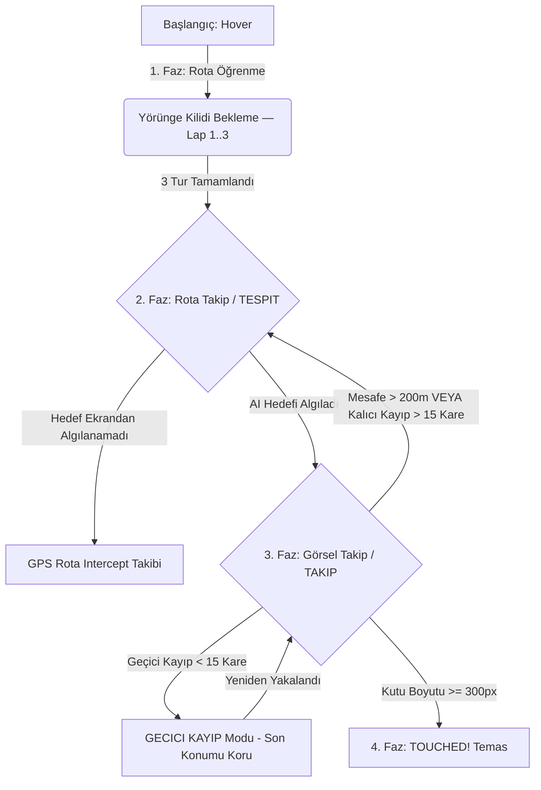

# Rota Intercept ve Görsel Takip Birleşik Sistemi (Combined Interceptor)

Bu rehber, rota öğrenme/yakalama (interception) algoritması ile gerçek zamanlı yapay zeka tabanlı görsel hedef takibi (visual servoing) sistemini tek bir koordineli yapıda birleştiren **Combined Tracker Intercept** mimarisini, kullanılan modülleri ve yapılan geliştirmeleri detaylandırmaktadır.

Sistem, hedef İHA'nın yörüngesini otomatik öğrenip en uygun intercept noktasını hesaplarken, hedef kamera görüşüne girdiği anda derin öğrenme tabanlı nesne tespiti ve görsel izleme PID kontrolcüleriyle hedefe kilitlenip temas (touch/kamikaze) senaryosunu icra eder.

---

## 1. Mimari Genel Bakış ve Modüller

Sistemin kalbi, aşağıdaki modüllerin koordineli çalışmasıyla oluşur:

### A. Giriş Noktaları (Harnesses)
*   **[test_combined_tracker_intercept.py](file:///home/tom/Documents/FIREFLY/tests/python/test_combined_tracker_intercept.py)**: TensorRT hızlandırmalı RF-DETR nesne tespit modelini ve SAHI dilimlemeli tespiti kullanan ana entegre betik.
*   **[test_combined_yolo_tracker_intercept.py](file:///home/tom/Documents/FIREFLY/tests/python/test_combined_yolo_tracker_intercept.py)**: CUDA ve TensorRT kütüphane bağımlılığı bulunmayan, Ultralytics YOLOv8 `.pt` ağırlıklarıyla ve arka planda çalışan hafif `ScreenCapture` sınıfıyla işleyen YOLO kopyası.

### B. Çekirdek Kütüphaneler ve Kontrolcüler
*   **[orbit_lock.py](file:///home/tom/Documents/FIREFLY/src/python/navigation/orbit_lock.py)**: GPS hedeflerinden elde edilen noktaları robust elips uydurma (ellipse fitting) yöntemiyle analiz eden, yörünge kilitlerini yöneten sınıf.
*   **[route_follow_guidance.py](file:///home/tom/Documents/FIREFLY/src/python/guidance/route_follow_guidance.py)**: Dronu elips rotası üzerine çeken carrot-pursuit kılavuzluk algoritması.
*   **PID Kontrolcüler**: Dronun fiziksel kontrol yüzeylerine (Yaw, Pitch, Throttle) komut üreten `YawPID`, `ThrottlePID` ve `SizePID` yapıları.

---

## 2. Durum Makinesi ve Çalışma Akışı (State Machine)

Sistem 5 ana fazdan oluşur ve aşağıdaki gibi akar:



### 1. Faz: Rota Öğrenme (Orbit Learning)
Dron kalkış yaptıktan sonra sabit bir yükseklikte hover'da bekler. Hedef İHA yörüngesinde turladıkça GPS verileri toplanır. `OrbitLockTracker` 3 tam tur yörünge kilidi (`orbit_count >= 3`) elde edene kadar elips parametrelerini çıkarır.

### 2. Faz: Rota Takip / TESPIT
Yörünge kilitlendikten sonra elips parametreleri dondurulur (frozen). Dron, `solve_intercept` tarafından hesaplanan dinamik yakalama noktasına (intercept point) doğru yüksek hızla (25 m/s) uçmaya başlar. Bu sırada derin öğrenme modeli (RF-DETR veya YOLO) sürekli ekranı analiz eder.

### 3. Faz: Görsel Takip / TAKIP
Kamerada hedef İHA algılandığı anda görsel servo algoritması devreye girer:
*   **Hizalama**: Hedef ekranın tam merkezine getirilmeye çalışılır.
*   **Geçiş**: Dron, intercept rotasından çıkıp tamamen kameradaki hedefe yönelir.

### 4. Faz: Temas (Touchdown / Kamikaze)
Hedef kutu boyutu (genişlik veya yükseklik) `300` piksele ulaştığında dron hedefe dokunmuş kabul edilir. Ekran üzerinde kırmızı "TOUCHED!" uyarısı basılır ve otonom görev başarıyla tamamlanır.

---

## 3. Sistem Üzerinde Yapılan Temel Geliştirmeler

### 1. Kilit Alanı (ROI) Sınırlarının Kaldırılması
> [!NOTE]
> Klasik görsel servoda sadece ekranın ortasındaki dar kilit alanı (lock zone) içindeki tespitler takibe başlarken, yeni yapıda bu sınırlar kaldırılmıştır. Ekranın herhangi bir yerinde yapılan ilk tespit anında takibi başlatır ve görsel servo dronu hedefe doğru yönlendirir.

### 2. Sabit Pitch Açısıyla İlerleme (No Deceleration)
> [!IMPORTANT]
> Görsel servo aktifken dronun yavaşlamasını önlemek için pitch stick komutu (`fp_final`) rotayla karıştırılmamakta (blend edilmemekte) ve doğrudan **sabit -25 derece** öne yatış açısına eşitlenmektedir. Böylece dron hedefi yakaladığında durma veya yavaşlama eylemi yapmadan tam gaz ileri atılır.

### 3. Anlık Takip Kayıpları İçin Tolerans (Grace Period Buffer)
Görüntü işleme sırasında anlık parlama, açı değişimi veya model duraksamalarından kaynaklanan kısa süreli takip kayıpları için esneklik getirilmiştir:
*   Hedef skoru eşik değerin (`0.70`) altına düşerse dron hemen tespit fazına geri dönmez.
*   Arka planda **15 karelik** (`MAX_LOST_FRAMES = 15`) bir geçici kayıp tamponu çalışır.
*   Bu süre zarfında ekranda turuncu renkli `GECICI KAYIP` yazar ve hedef kutusunun en son geçerli konumu korunur; böylece PID kontrolcüleri hedefin son yönüne doğru uçmaya devam eder.
*   15 kare içinde hedef tekrar bulunursa kayıp sayacı sıfırlanır. Aksi halde `TESPIT` fazına dönülür.

### 4. Maksimum Mesafe Emniyet Sınırı (Max Distance Guard)
> [!WARNING]
> Çok uzak mesafelerdeki hatalı AI tespitlerinin dronu rotadan çıkarmasını önlemek için `MAX_TRACKING_DISTANCE_CM = 20000.0` (200 Metre) sınırı eklenmiştir. Hedef 200 metreden uzaksa görsel takip anında sıfırlanarak dronun intercept rotasını izlemesi sağlanır.

### 5. Yörünge Kilitlenme Şartlarının Esnetilmesi
*   [orbit_lock.py](file:///home/tom/Documents/FIREFLY/src/python/navigation/orbit_lock.py) dosyasındaki yön (`omega` işareti) tutarsızlığı ve merkez koordinat sıçraması doğrulamaları devre dışı bırakılmıştır. Bu sayede yörünge kestiriminin sık sık reddedilmesi (önceki kilidin korunması) engellenmiş, her geçerli elips tahmini doğrudan kilit olarak kabul edilmiştir.

### 6. Performans ve Akıcılık İyileştirmeleri (FPS & Video Fix)
*   **AI İnferans Optimize Edildi**: Derin öğrenme modeli yalnızca `TESPIT` fazında (hedef aranırken) çalıştırılır. `TAKIP` fazında ise yalnızca TCTrack izleyicisi çalışarak döngü hızı **30+ FPS** seviyesine çıkarılmıştır.
*   **Video Hızlanma Sorunu Düzeltildi**: Kaydedilen MP4 videoların aşırı hızlı oynaması, döngünün gerçek geçen zaman adımı `dt` oranında kare kopyalama yöntemi uygulanarak çözülmüştür.
*   **Ekran Birleştirme Gecikmesi Kaldırıldı**: Matplotlib rota haritası panosunun OpenCV video karesine side-by-side olarak birleştirilmesi, `fig.canvas.draw()` komutunun döngüyü 5-10Hz seviyelerine yavaşlatması (ve dolayısıyla dronun titremesine yol açması) nedeniyle iptal edilmiş; döngü akıcılığı 50Hz seviyesine tekrar yükseltilmiştir.

---

## 4. Parametreler ve Kalibrasyon Tablosu

| Parametre İsmi | Varsayılan Değer | Açıklama |
| :--- | :--- | :--- |
| `DET_CONF_THRESHOLD` | `0.45` | RF-DETR / YOLOv8 hedef tespit güven eşiği |
| `TRACKER_LOST_SCORE` | `0.70` | TCTrack modelinin takip kayıp eşiği |
| `MAX_TARGET_AREA_RATIO` | `0.07` / `0.09` | Ekran alanına göre hedefin maksimum kaplama oranı |
| `MAX_LOST_FRAMES` | `15` kare | Geçici kayıp durumunda tolerans gösterilecek maksimum kare sayısı |
| `MAX_TRACKING_DISTANCE_CM`| `20000.0` cm | Görsel servonun çalışacağı maksimum mesafe (200m) |
| `SERVO_ATTACK_PITCH_DEG` | `-25.0` derece | Görsel takip sırasında uygulanan öne doğru yatış açısı |
| `target_touch_size` | `300.0` piksel | Dronun hedefe çarptığını doğrulayan bounding box boyutu |

---

## 5. Çalıştırma Talimatları

### TensorRT Sürümü (Ana Kod)
```bash
# Simülasyon modunda çalıştırmak için:
python3 tests/python/test_combined_tracker_intercept.py --sim

# Canlı dron SDK bağlantısıyla çalıştırmak için:
python3 tests/python/test_combined_tracker_intercept.py
```

### YOLOv8 Sürümü
```bash
# Simülasyon modunda çalıştırmak için:
python3 tests/python/test_combined_yolo_tracker_intercept.py --sim

# Canlı dron SDK bağlantısıyla çalıştırmak için:
python3 tests/python/test_combined_yolo_tracker_intercept.py
```
